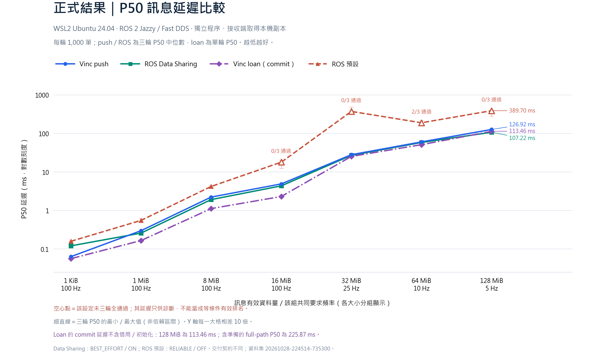
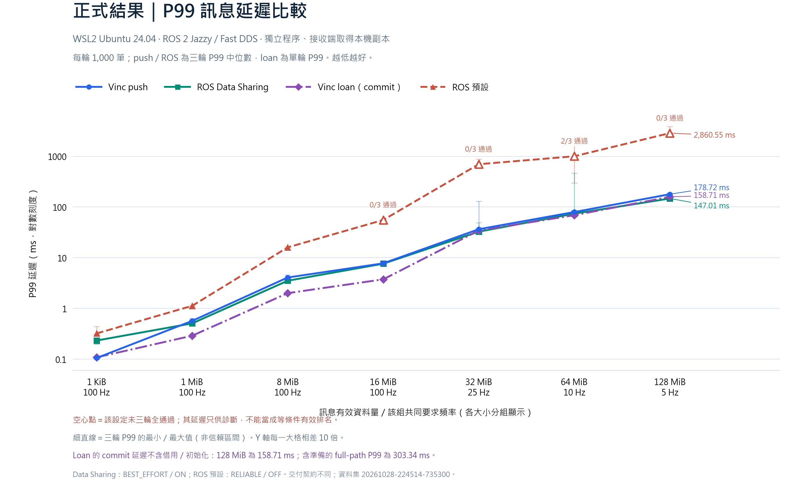

# Open-VINC Benchmarks

Reproducible native Open-VINC pub/sub workloads and a framework-independent analyzer.
The Publisher and Subscriber are real Modules in separate ModuleHost processes;
data travels through Context and the shared-memory Message Bus. No ROS installation
is required for the Vinc workload. This is an independent harness, not an Apex.AI
`performance_test` plugin. An optional [ROS 2 rclcpp workload](ros2/README.md)
and sequential comparison controller are available for Ubuntu 24.04/Jazzy.

可重現的 Open-VINC 原生測試與跨框架共用分析器。發布與接收 Module 分屬獨立程序，
透過正式 Context／Message Bus／pumpLoop；Vinc 測試不需要安裝 ROS。
另提供 Ubuntu 24.04／Jazzy 的 ROS 2 原生工作負載及同機比較控制器；
它不是 Apex.AI 後端。跨框架測法與設定見 [ROS 說明](ros2/README.md)。

## Recorded baseline / 本次結果

**2026-10-28–29 · WSL2 Ubuntu 24.04.5 · Ryzen 7 5700X3D · GCC 13.3 · Release.**
ROS 2 Jazzy uses `rmw_fastrtps_cpp` / Fast DDS 2.14.7. Each case has one Publisher
and one Subscriber in separate processes; the receiver gets a process-local copy.
This is a paced WSL workload, not maximum throughput or native Linux certification.

本次保留為效能 baseline，暫不進行效能優化。每輪 64 筆暖身、1,000 筆正式訊息；
Vinc push／兩種 ROS 設定各三輪，Vinc loan 另做一輪。
Ring/history 深度 32，128 MiB 使用 30；實際 Vinc Bus 配置最大約 3.750 GiB，低於 4 GiB。
頻率先校準再凍結；高負載失敗試跑與正式失敗都保留。

### P50



### P99



Both charts use a logarithmic Y axis; lower is better. Thin bars show the range
of the three per-run percentiles, not confidence intervals. Hollow points are
diagnostic results from settings that did not pass all three runs.

**縱軸是對數刻度。** push／ROS 是三輪各自百分位數的中位數，loan 是單輪。
空心點未三輪全通過，不能拿存活樣本的延遲當成等條件有效排名。

P99 below is in **milliseconds**. `— (n/3)` means the default ROS setting did not
qualify in all rounds; its surviving-sample latency remains available in the data.

| Payload | Common Hz | Vinc push | Vinc loan† | ROS Data Sharing | ROS default |
|---|---:|---:|---:|---:|---:|
| 1 KiB | 100 | 0.105 | 0.109 | 0.233 | 0.322 |
| 1 MiB | 100 | 0.569 | 0.290 | 0.507 | 1.126 |
| 8 MiB | 100 | 4.074 | 2.001 | 3.519 | 15.994 |
| 16 MiB | 100 | 7.746 | 3.749 | 7.621 | — (0/3) |
| 32 MiB | 25 | 36.449 | 34.352 | 32.624 | — (0/3) |
| 64 MiB | 10 | 79.531 | 68.881 | 73.908 | — (2/3) |
| 128 MiB | 5 | 178.721 | 158.708 | 147.014 | — (0/3) |

**† Loan measures commit → callback, excluding acquisition/initialization.**
At 128 MiB its P99 is 158.708 ms, while preparation → callback P99 is 303.336 ms.
Push reuses an initialized local message; loan initializes each borrowed message.
These preparation workloads differ, so the loan curve is supplementary.

**Loan 紫線不含準備成本，不能直接當成整體加速。** ROS Data Sharing 為
BEST_EFFORT、明確 ON、有界訊息；ROS 預設為 RELIABLE、Data Sharing OFF。
兩者與 Vinc 的覆寫／讀取保護契約不同，並非相同可靠性保證。

Vinc push and tuned ROS each passed **21/21** formal cases; default ROS passed
**11/21**. Formal Vinc collision/loss/overwrite counts were zero. All **116**
attempts reproduced their saved P50/P90/P99/max from raw samples. Payload checking
covers length, sequence and edge markers, not a full payload hash.

調校後 ROS 與 Vinc 接近，部分大小更快；尾端變動亦需閱讀。例如 64 MiB 的三輪 P99：
Vinc 約 77–81 ms、Data Sharing 約 68–466 ms。背景桌面負載未隔離；
本次結果不代表所有 ROS 後端、平台、拓樸或硬即時保證。

- [Dataset, raw CSV, checksums, chart source and verification / 數據與核對方式](reports/2026-10-28-wsl-ros2/README.md)
- [Experiment details and setup corrections / 方法與診斷修正](docs/ROS_COMPARISON.md)
- [Native workload](native/) · [ROS workload](ros2/) · [Analysis and runners](tools/) · [Tests](tests/)

## Get the pinned source / 取得固定版本

```sh
git clone --recurse-submodules https://github.com/JayTDawgzone1994/open-vinc-benchmarks.git
cd open-vinc-benchmarks
```

Open-VINC is pinned to `a3a0843c5dc89f8b052c5f25afa66e1f171db99e`, including notification-driven
pumpLoop. CMake rejects a different submodule revision. Update the gitlink and
`cmake/open-vinc-revision.txt` together when intentionally changing the tested version.
The submodule is never patched by this project. Initial recursive checkout also obtains
Open-VINC's existing dependencies and their licenses.

框架固定於上述 commit，包含通知喚醒。修改受測版本時須一起更新 submodule 與版本檔，
不自動追分支，也不改動第三方來源。

## Build / 建置

C++23 and CMake 3.20+ are required; exact validated tools are in [validation](docs/VALIDATION.md).
Use one configuration per build directory. Windows requires an **MSVC x64 Developer shell**
and Ninja, matching the Plugin/Host toolchain and CRT.

```sh
cmake -S . -B build/release -G Ninja -DCMAKE_BUILD_TYPE=Release
cmake --build build/release --target vinc_benchmark --parallel 4
ctest --test-dir build/release --output-on-failure
```

On Ubuntu 24.04, add `-DCMAKE_CXX_COMPILER=g++-13` if needed. Python 3.10+ is used for
execution and analysis; the tools use only its standard library. macOS validation
of this suite is pending. WSL results must be labeled WSL, not native Linux results.

Ubuntu 24.04 可明確指定 GCC 13。Python 工具只使用標準函式庫；本專案的 macOS 驗證尚待補上。
CTest 執行分析器契約測試及 push／loan 小型跨程序測試，冒煙數字不是正式效能報告。

## Measure / 執行量測

```sh
python -m tools.run --build-info build/release/benchmark-build-Release.json
```

Defaults: 1 KiB, 1 MiB and 8 MiB payloads; push and loan; one Publisher/Subscriber;
eight slots; requested 100 Hz; 64 warmup + 1,000 formal samples; three interleaved
rounds. A central process supervises both Hosts. The per-case shared budget is 4 GiB,
not a total process-memory limit. Capacity/rate never auto-adjust to hide overload.

預設每組三輪；容量／頻率固定，碰撞或漏收會使該組不合格，所有結果保留。
單次執行會在 `results/` 內建立新的時間戳資料夾，不覆蓋舊結果。
原始資料與建置產物預設不進 Git；要發布的結果須連同環境與原始證據另行整理。

Examples / 範例：

```sh
# Short functional check, not a reliable P99 estimate.
python -m tools.run --build-info build/release/benchmark-build-Release.json --sizes-bytes 1024 --samples 32 --repeats 1

# Explicit Windows-only experiment; this is not a framework default.
python -m tools.run --build-info build/release/benchmark-build-Release.json --pacing windows-highres
```

Standard pacing uses `sleep_until` on a fixed monotonic grid. Missed ticks are
counted and skipped, never replayed as catch-up bursts. A request of 100 Hz is not
an achieved-rate guarantee. Windows high-resolution pacing uses a reused blocking
waitable timer; it does not spin, change timer resolution globally, raise priority,
or silently fall back when unavailable.

預設沿用標準等待 API，不把實際約 64 Hz 寫成 100 Hz。高解析度 timer 為獨立標示的
Windows 實驗模式，失敗會回報，不會偷偷降級。

## Analyze and compare / 分析與比較

```sh
python -m tools.analyze results/SESSION/r1-push-1024
python -m tools.analyze FIRST_NORMALIZED_RUN SECOND_NORMALIZED_RUN --output comparison.json
```

The analyzer consumes [normalized schema v1](docs/SCHEMA.md), without importing Vinc.
It verifies sample IDs, trailing loss, duplicates, content flags, time boundaries,
clock domain and transport counters. P50/P90/P99 use nearest rank on formal valid
samples; a failed run remains failed even if its surviving samples look fast.
Comparison rejects incompatible environment, data size, ownership, rate, queue,
configuration and timing contracts. Use `--allow-pacing-difference` only for an
explicit pacing experiment. A matching fingerprint is not proof of identical hosts
or ambient load; the experiment owner must establish that independently.

共用分析器可由其他框架匯出相同格式後使用；目前沒有 Apex CSV 自動匯入器。
它不會從平均值猜出 P99，也不會把借用共享資料與已取得本機副本默認為相同工作。

## ROS 2 comparison / ROS 2 同機比較

The optional ament package is built separately with colcon; the root CMake build
does not require ROS. See [build commands, QoS and ownership](ros2/README.md).
`python3 -m tools.compare` retains all pilots, calibrates a common rate for Vinc
push and tuned ROS, then freezes the formal case for three 1,000-sample repeats.
Default ROS and native loan remain separately labeled. Sizes extend through
128 MiB, native shared budget 4 GiB. No automatic changes occur within a run.

ROS 預設設定與調校後的 Data Sharing／SHM 路徑分開；先保留 100 Hz 壓力試跑，
再用共同可維持的頻率做正式對照。每次結果保留原始資料，不默默排除漏收或碰撞。
以 `python3 -m tools.comparison_report RESULTS_DIRECTORY` 產生繁體中文報告。
Recorded WSL results and important setup corrections:
[ROS comparison / ROS 對照紀錄](docs/ROS_COMPARISON.md).

Read [methodology](docs/METHODOLOGY.md), [native lifecycle](native/README.md),
[validation and limits](docs/VALIDATION.md), and [third-party attribution](THIRD_PARTY.md).

## License / 授權

Apache-2.0; retain [LICENSE](LICENSE) and [NOTICE](NOTICE).
Open-VINC's existing license deployment accompanies the native artifacts;
this suite also copies its LICENSE/NOTICE into `licenses/open-vinc-benchmarks`.
Distributors must preserve both sets. No Apex source is
incorporated; the methodology is informed by its [performance_test project](https://gitlab.com/ApexAI/performance_test).
